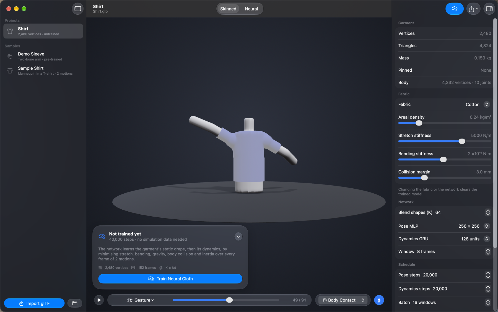

# Neural Cloth Studio

Train **neural cloth** for real-time characters on a Mac. Bring a skinned body, a garment and some animation as glTF.
Neural Cloth Studio trains a small network that adds pose-dependent wrinkles, folds and sway to the garment, cheaply
enough for many characters on screen at once.

- **No simulation data.** Training is unsupervised: the network minimises the garment's physical energy (stretch,
  bending, gravity, body collision and inertia) on your Mac's GPU, following *Neural Cloth Simulation* (Bertiche et al.,
  SIGGRAPH Asia 2022) and *SNUG* (Santesteban et al., CVPR 2022).
- **Bring your own garment.** Import `.glb` or `.gltf` scenes from Blender, Maya or any glTF exporter. Garments can be
  skinned or unskinned; the app transfers weights from the body and welds UV seams so the cloth can't tear. The
  in-app guide (Help › Bring Your Own Garment) has the Blender export settings.
- **Engine-ready output.** Export a baked glTF with morph targets that Blender, Unreal, Unity, Godot and three.js play
  directly, or the small model itself (K blend shapes plus a tiny network) for a real-time runtime.
- **Comes with samples.** A pre-trained demo sleeve and a mannequin in a T-shirt with two motions.
- **Command-line tool included:** `neural-cloth scene | import | train | evaluate | export-gltf`.

## Download
Get **NeuralClothStudio-1.0.0-macOS.dmg** from [Releases](https://github.com/theisegoria/neural-cloth-studio/releases/latest),
open it and drag Neural Cloth Studio to Applications. The `neural-cloth` tool is in the DMG's *Command Line Tool* folder.

Requires macOS 27 on Apple silicon. The app is signed with a Developer ID but not notarized. The first time, right-click it in Applications and choose **Open**, then **Open** again.

## Licence
Free to use, including for commercial work. See [LICENSE](LICENSE).
